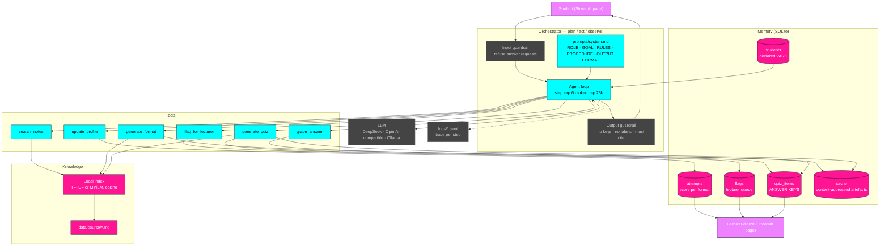
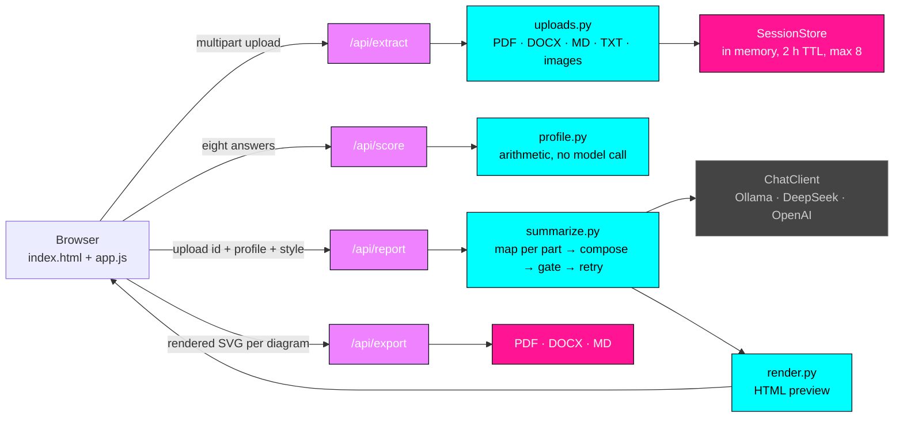
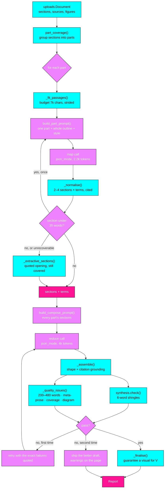

# Architecture

VARK Check is a small, boring, auditable agent. That is the design goal: every
decision that must be reliable (scoring, guardrails, comparison) is deterministic
Python, and the language model is confined to the parts where language is
actually needed (explaining, rendering, judging free text).

## What goes in, what comes out

**Input**

- a pseudonymous student id;
- eight self-report answers (declared preference — a hypothesis, never a rule);
- a topic chosen from `data/course/`;
- free-text quiz answers;
- free-text questions ("explain this", "give me the answers").

**Knowledge**

- only `data/course/*.md | .txt | .pdf`, chunked by heading and indexed locally.

**Tools** — seven, all typed, all side-effecting in a controlled way:
`search_notes`, `generate_format`, `generate_quiz`, `grade_answer`,
`update_profile`, `flag_for_lecturer`, `schedule_review`.

**Decisions**

- which tool to call next, and when to stop (the model);
- whether an input is an attempt to extract answers (code, before the model);
- whether an output leaks a key, lacks a citation, or labels a learner (code, after the model);
- which format scored best and what to suggest next (code, arithmetic only).

**Output**

- one artefact per format (V/A/R/K), with `source:` citations;
- three quiz questions, keys held server-side;
- a score plus an explanation of *why*, not a model answer;
- a neutral comparison of declared vs observed;
- a lecturer digest: the three concepts the cohort has not grasped, with sources;
- a JSONL trace of every step, tool call, latency and token count.

## Map



Legend — cyan: our code; purple: entry points; pink: data at rest; grey:
third-party or artefacts. Answer keys are deliberately in the data layer *only*:
no prompt that produces student-facing text ever receives them.

## The loop

```
messages = [system prompt] + [state block] + [request]
for step in 1..6:
    reply  = llm(messages)                      # plan
    action = parse_json(reply)                  # strict, retried twice
    if action == "final":  return output_guardrail(reply.message)
    result = run_tool(action.name, action.args) # act
    messages += [action_as_json, "OBSERVATION: " + result.summary]   # observe
return handover("I've flagged this for your lecturer.")
```

Two stopping conditions, both enforced in Python rather than hoped for in the
prompt: `AGENT_MAX_STEPS` and `AGENT_TOKEN_BUDGET`. Both end in the same
human hand-over path, which also writes a row into `flags`.

### Why the loop is not the only path

`Agent.deliver()`, `.quiz()` and `.grade()` run the loop and then **verify** that
the expected tool actually ran (and, for grading, that an attempt was written).
If the model forgets, or returns something unusable, the same tool is called
directly and the trace records `agent.fallback`. A live demo should not depend on
a model making the right choice on the first try.

## Guardrails — three checks, all in code

| Check | Where | What it stops | Cost |
|---|---|---|---|
| `check_student_input` | before any model call | "give me the answers", "do my exercise", Italian equivalents | 0 tokens |
| `check_agent_output` → labelling | before display | "you are a visual learner", "visual learners should…" | 0 tokens |
| `check_agent_output` → key leak | before display, in grading | any stored answer key appearing in feedback | 0 tokens |
| `check_agent_output` → citation | before display, in generation | uncited or fabricated `source:` | 0 tokens |

The prompt *also* states these rules. The difference is that a prompt can be
argued with and these cannot: the checks run on the string, whatever produced it.

## Memory

See `varkcheck/store.py`. SQLite, one file, no server:

- `students(id, declared, created_at)`
- `attempts(student_id, topic, format, score, max_score, ts)`
- `flags(concept, reason, student_id, topic, ts)`
- `quiz_items(... answer_key, rubric, graded, awarded ...)` — the vault
- `reviews(student_id, topic, due_date)` — optional spaced repetition
- `cache(key, payload)` — content-addressed artefacts (topic + format + material hash)
- `messages(session_id, role, content)` — conversation history, truncated on reuse

The cache is why the fifth run of the same demo is instant and free: the key is
`sha256(topic | format | material_hash)`, so editing a lecture note invalidates
it and nothing else does.

## Retrieval

`varkcheck/rag.py`

1. Heading-aware chunking (≤ 1200 chars) → every chunk carries `doc + section`
   (plus page for PDFs), so a citation is always verifiable.
2. Default space: corpus-fitted TF-IDF, L2-normalised, cosine similarity, plus a
   bounded bonus for section-title term overlap. Pure Python: no download, no GPU,
   deterministic on any machine.
3. Optional: `VARK_EMBEDDER=sentence-transformers` swaps in MiniLM with the same
   interface and the same persisted format.
4. The index is a JSON matrix, rebuilt automatically when the material hash
   changes.

This is a real vector store, just a small one: the brief's "local embeddings +
simple vector store" without a dependency that can fail the night before a demo.

## Token budget

| Where | Tokens | Note |
|---|---|---|
| `search_notes` observation | ≤ 600 chars | 3 snippets, capped |
| `generate_format` | ~2k in / ~500 out | cached per topic+format |
| `generate_quiz` | ~2.2k in / ~450 out | cached and shared across students |
| `grade_answer` (3 answers, 1 call) | ~1.5k in / ~700 out | batched |
| orchestrator history | grows, bounded by 6 steps | artefacts stay out of context |

≈ 2¢ per student-topic, ≈ 6¢ per student for three topics. The full arithmetic
is in the README.

---

# v2 — the local app (`python -m varkcheck.web`)

v1 keeps the material fixed and varies the format. v2 does the opposite: the
material is whatever the user uploads, and the profile picks the shape. The
architecture is deliberately similar — deterministic Python around model calls —
because the same argument applies: anything that must be *true* about the report
is checked in code, not requested in the prompt.

## Request path



*(legend: cyan = deterministic Python, purple = HTTP endpoint, pink = state and
generated files, grey = the one external service.)*

## Why the report is built on the server

A `file://` page cannot keep an API key off the client, cannot assemble a PDF,
and cannot reach a local model without CORS. The server is stdlib
`ThreadingHTTPServer`; v2 adds no web framework. Uploads live in RAM, keyed by a
random token, and are deleted with the session directory — there is no database
anywhere in v2.

## The report pipeline

Two passes. The first is a **map** over the material, one model call per part;
the second is a **reduce** that turns the part summaries into one document. This
is what makes coverage structural: a call that never received a lecture cannot
summarise it, and the composing call receives every part's sections.



*(legend: cyan = deterministic Python, purple = control flow and model-facing
prompts, pink = data carried between passes, grey = the external service.)*

The part pass is deliberately modest: 2–4 sections per part, 90–160 words each,
plus up to three key terms. Asking a small model for a whole report's worth of
prose in one reply is how the opening lecture gets summarised and the rest is
lost; asking it for one lecture at a time is a task an 8B model can finish. The
composing pass then does only what needs the whole document in view: title,
200–480-word overview, diagrams, comparison table, self-checks, study plan.

Each check answers a different question, and none of them can be satisfied by
prompt wording alone:

| Check | Question | Failure mode it prevents |
|---|---|---|
| `synthesis.check` | are these sentences the source's sentences? | a report that is an excerpt with new headings |
| `part_coverage` / per-part calls | was every part actually read? | three sections about the first lecture, silence on the rest |
| `_missing_parts` | does the overview name every part? | a summary that is about one chapter |
| `_quality_issues` | is this a summary, of the subject, in the right shape? | thin overviews, "This report covers…", a visual report with no visual |
| `_normalise` citations | is each `source:` a passage we actually sent? | invented `file §section` references |

Two failures in a row do not become an error page: the report ships and the page
states what is wrong with it. A wrong report that admits it is recoverable; a
missing report is not.

## When a part cannot be summarised

The per-part pass retries once with the thin section names quoted back at it. If
it still returns nothing usable, the part is carried into the report as a
**quoted opening** (`_extractive_sections`) and the page says so. That is a
deliberate ordering of failures: quoting breaks the copy rule, dropping the part
breaks the coverage promise, and the student can see a quotation but cannot see
what is absent. The same reasoning drives the "better of two drafts" rule in the
composing pass.

## Style is structure, not colour

`_assemble()` enforces the shape: **A** drops every diagram and table, **R**
drops diagrams, **K** keeps at most one. A visual report that the model failed to
illustrate is given a hierarchy chart built from the document's own headings
(`fallback_diagram`), captioned as such.

## Diagram rendering without Node

Mermaid is vendored (`static/mermaid.min.js`, 10.9.1). The report arrives in a
`srcdoc` iframe with `sandbox="allow-same-origin"` — the report itself runs no
scripts. The **parent** page initialises Mermaid and renders over the iframe's
DOM, collects the SVG per diagram, and posts them back with the export request.
PDF embeds them as vector images; DOCX rasterises them with `cairosvg`; Markdown
keeps the Mermaid source, which is the useful form in a repository.
